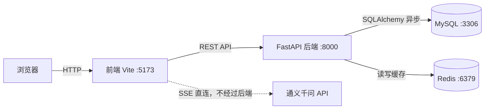

# 新闻资讯平台后端（toutiao_backend）

基于 **FastAPI + MySQL + Redis** 的新闻资讯平台后端服务，涵盖新闻浏览、用户体系、收藏与浏览历史，针对高频读取场景引入 Redis 缓存。项目另配前端（Vue 3 + Vite）用于联调，其中 AI 问答由**前端直连** OpenAI 兼容接口（通义千问）实现流式输出，**该链路不经过本后端**。

## 技术栈

| 层次 | 技术 |
|---|---|
| Web 框架 | FastAPI（异步）+ Uvicorn |
| 数据库 | MySQL 8.0（SQLAlchemy 2.0 异步 + aiomysql） |
| 缓存 | Redis（Cache-Aside 模式，分级 TTL） |
| 鉴权 | UUID Token + bcrypt 密码哈希 |
| 前端 | Vue 3 + Vite + Pinia（联调用，非本仓库代码） |
| 大模型 | 前端直连通义千问（OpenAI 兼容接口 + SSE 流式，后端不参与） |

## 架构



## 项目结构

```
toutiao_backend/
├── main.py              # 应用入口：CORS、异常处理器、路由注册
├── config/              # 数据库、Redis 连接配置（敏感信息走 .env）
├── models/              # SQLAlchemy ORM 模型
├── schemas/             # Pydantic 请求/响应模型
├── crud/                # 数据访问层（含缓存读写）
├── routers/             # 接口层：news / users / favorite / history
├── cache/               # 缓存工具函数（JSON 序列化 + TTL）
├── utils/               # 鉴权依赖、统一响应、异常处理、加密
├── docs/                # 接口规范文档、数据库 SQL 脚本
├── .env.example         # 环境变量模板（真实值不提交）
└── requirements.txt
```

## 快速启动

### 1. 准备环境

- Python 3.11+、MySQL 8.0、Redis（Windows 可用 [tporadowski/redis](https://github.com/tporadowski/redis/releases) 5.0）

### 2. 配置环境变量

```bash
cp .env.example .env
# 编辑 .env，填入真实的数据库连接串
```

### 3. 安装依赖并初始化数据库

```bash
pip install -r requirements.txt
# 导入 docs/02-数据库sql文件/database.sql，创建 news_app 库及表结构
```

### 4. 启动

```bash
uvicorn main:app --reload
# 接口文档：http://127.0.0.1:8000/docs
```

## 接口列表（共 17 个）

### 新闻（公开）

| 方法 | 路径 | 说明 |
|---|---|---|
| GET | `/api/news/categories` | 新闻分类（缓存 7200s） |
| GET | `/api/news/list` | 新闻列表，支持分页/分类筛选（缓存 1800s） |
| GET | `/api/news/detail` | 新闻详情（缓存 300s） |

### 用户

| 方法 | 路径 | 鉴权 | 说明 |
|---|---|---|---|
| POST | `/api/user/register` | ❌ | 注册（bcrypt 加盐存储） |
| POST | `/api/user/login` | ❌ | 登录，签发 UUID Token（7 天有效） |
| GET | `/api/user/info` | ✅ | 获取用户信息 |
| PUT | `/api/user/update` | ✅ | 修改资料 |
| PUT | `/api/user/password` | ✅ | 修改密码 |

### 收藏（需登录）

| 方法 | 路径 | 说明 |
|---|---|---|
| GET | `/api/favorite/check` | 是否已收藏 |
| POST | `/api/favorite/add` | 添加收藏 |
| DELETE | `/api/favorite/remove` | 取消收藏 |
| GET | `/api/favorite/list` | 收藏列表（分页） |
| DELETE | `/api/favorite/clear` | 清空收藏 |

### 浏览历史（需登录）

| 方法 | 路径 | 说明 |
|---|---|---|
| POST | `/api/history/add` | 记录浏览历史 |
| GET | `/api/history/list` | 历史列表（分页） |
| DELETE | `/api/history/delete/{id}` | 删除单条 |
| DELETE | `/api/history/clear` | 清空历史 |

## 缓存设计

采用 **Cache-Aside**（旁路缓存）模式，按数据变更频率分级设置 TTL：

| 缓存对象 | Key 示例 | TTL | 理由 |
|---|---|---|---|
| 新闻分类 | `news:categories` | 7200s | 几乎不变 |
| 新闻列表 | `news_list:{page}:{category_id}:{size}` | 1800s | 低频更新 |
| 新闻详情 | `news:detail:{id}` | 300s | 阅读量等字段更新较频繁 |

读取顺序：**Redis → 未命中则查 MySQL → 回写 Redis（带 TTL）**。列表 key 按「分类 + 分页」维度拼接，保证不同视图互不污染。

## 鉴权设计

- 密码使用 **bcrypt 加盐哈希**存储，不存明文
- 登录后签发 **UUID Token**，持久化到 `user_token` 表（含过期时间），同一账号重复登录覆盖旧 Token
- 受保护接口通过 FastAPI 依赖注入 `Depends(get_current_user)` 统一校验 `Authorization: Bearer <token>`，无效/过期返回 401
- 相比 JWT：服务端可**主动作废** Token（删除记录即失效），适合需要"踢下线"的场景

## 已解决的问题（踩坑记录）

- **Redis 5.0 与新版 redis-py 协议不兼容**：新版客户端握手发送 `HELLO 3`，Redis 5.0 不识别导致连接静默失败；指定 `protocol=2` 使用 RESP2 协议解决
- **重复登录后 Token 失效**：Token 更新分支缺少事务提交，导致返回给客户端的新 Token 未持久化；统一提交后修复
